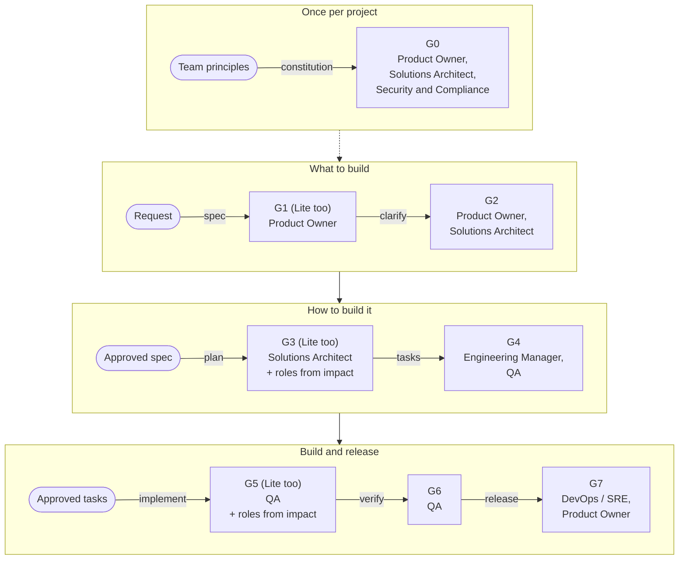
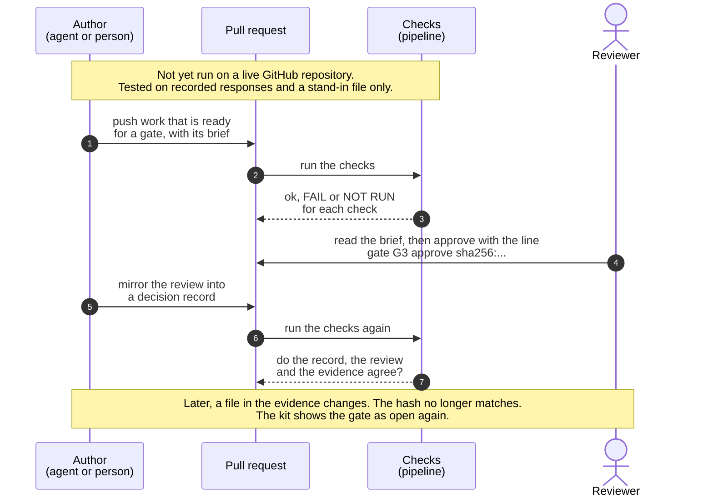
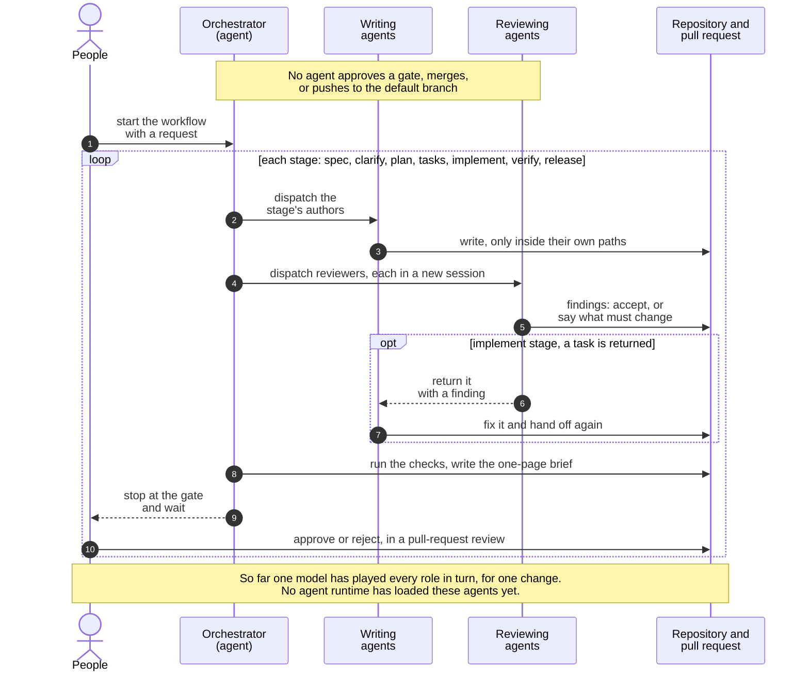
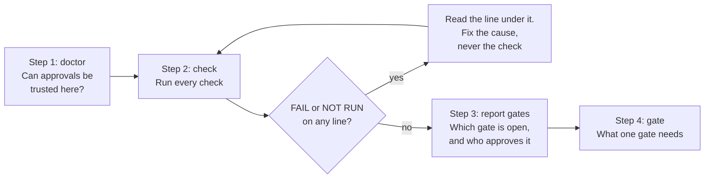

# agentic-spec-kit

> **Status: pre-alpha, public.** All six slices (0.1 to 0.6) are built: 105 checks, each with a passing and a failing fixture. The kit has been used once on real work, and it has never been run against a live GitHub repository, a live tracker or a chat service. Do not rely on it for real work.
> [Status in detail](#status-in-detail) has the particulars. [`docs/limits.md`](docs/limits.md) lists what the kit does not do.

An Agentic Specification-Driven Development toolkit that builds on
[github/spec-kit](https://github.com/github/spec-kit). Agents draft, build and
verify. Named humans approve at every gate. Nothing advances on an agent's say-so.

A change is treated as a change to a system: every spec knows which data stores,
shared components, contracts and other applications it touches, who owns them, and
who must approve.

## Start here

Find the row that says what you want. The last column is for people who work with a coding agent: say the sentence to it, or type the name with a slash in front.

| You want to | Read | Or ask Claude Code or GitHub Copilot |
|---|---|---|
| Watch it first, in five minutes | [A video guide](https://youtu.be/l3Xegefi2TQ) to what the kit is, why it exists and how to use it | |
| See it work, in ten minutes | [Try it](#try-it), then [Your first day](#your-first-day) | In a clone of this repository: "Give me the agentic-spec-kit tour." (skill `agentic-spec-kit-try`) |
| Put it on a project | [`docs/install.md`](docs/install.md) | In a clone of this repository: "Install agentic-spec-kit into my project." (skill `agentic-spec-kit-install`) |
| Know what to do next, in a project that has it | [How one change moves](#how-one-change-moves) | `/speckit.agentic.guide` |
| Review a change you did not write | [Who does what](#who-does-what) | "Review this change independently." (skill `agentic-spec-kit-review`, in any repository) |
| Approve at a gate | [What happens on a pull request](#what-happens-on-a-pull-request) and [`docs/guide/roles.md`](docs/guide/roles.md) | No agent can do this for you |
| Set up the repository so that approvals count | [`docs/admin-setup.md`](docs/admin-setup.md) | No agent can do this for you |
| Know what the kit cannot do | [`docs/limits.md`](docs/limits.md) | |

## What you do, by role

A role is a job at a gate. `roles.yml` says which person holds which role, and one person may hold several. The table gives the defaults. A project can change the approvers in `kit.yml`.

| If you are | With the kit you | Start with |
|---|---|---|
| An engineer who builds: backend, frontend or AI | Work one task at a time, inside the files the task names. Run `check` before you ask for a review, and name each test after the criterion it proves. At Standard and Regulated you also approve: at G3 when a change touches a component you own or one a step away from it, and at G5 when it touches yours | [Your first day](#your-first-day), and [the life of one task](docs/guide/workflow.md#1-the-life-of-one-task) |
| QA | Approve G4 with the Engineering Manager, then G5 and G6. You look at whether every criterion is traced to a passing test, and at what the independent verifier found | `agentic.py report trace --spec <spec>` |
| Solutions Architect | Approve G2 with the Product Owner, then G3. You look at whether the plan fits the system: what it touches, what it reaches, and its data and contract changes | `agentic.py impact --spec <spec>` |
| Product Owner | Approve G1, G2 and G7. You look at whether this is the right thing to build, and you decide each duplicate candidate | `agentic.py report gates` |
| Engineering Manager | Approve G4. You look at whether the work is cut into tasks with owners, paths and an order that can run | `agentic.py report gates` |
| DevOps / SRE | Approve G7 with the Product Owner. You look at readiness to run the change: rollout, rollback and alerts | `agentic.py report gates` |
| Security and Compliance | Approve G0, the constitution. You join G3 when a change touches something that holds protected data or comes within one step of it, and G5 when it touches it. You approve a waiver marked critical | `agentic.py report waivers` |
| Data Owner or Platform | Join G3 when a change touches a data store or a shared component, or comes within one step of one, and G5 when it touches one | `agentic.py impact --spec <spec>` |
| The repository's administrator | Protect the default branch and make `agentic-checks` a required status check. Without that the approver rules are convention | [`docs/admin-setup.md`](docs/admin-setup.md) |

A Lite project has G1, G3 and G5 only, and one approval by any listed role passes a gate. [`docs/guide/roles.md`](docs/guide/roles.md) has the exact rules, and what each role looks at.

## Use it with Claude Code or GitHub Copilot

The kit reaches a coding agent in three ways. All three are files in a repository, so they are reviewed like any other change.

**1. Three skills in this repository.** They are in [`.claude/skills/`](.claude/skills/), written to the open [Agent Skills](https://agentskills.io) format. Claude Code reads that folder. GitHub Copilot reads it too: GitHub's documentation names `.github/skills`, `.claude/skills` and `.agents/skills` as the places for a project's skills (read on 2026-11-23). So there is one copy, and it serves both.

| Skill | What it does | Where it works |
|---|---|---|
| `agentic-spec-kit-try` | A first tour on the sample project: five commands that write nothing, each result explained | In a clone of this repository |
| `agentic-spec-kit-install` | Installs the kit into a Spec Kit project and configures it, then walks you through what only people do | In a clone of this repository, working on your project |
| `agentic-spec-kit-review` | An independent review of a change, from the diff and the requirement alone: findings with file and line, then accept or return. It never edits | In any repository, with or without the kit |

Ask in plain words, or name the skill with a slash in front, as in `/agentic-spec-kit-try`. To have the review skill in another repository, copy its folder there:

```bash
mkdir -p .claude/skills && cp -R path/to/agentic-spec-kit/.claude/skills/agentic-spec-kit-review .claude/skills/
```

Use `.github/skills` in place of `.claude/skills` where the repository keeps its Copilot skills there.

**2. The kit's commands, in a project that has it.** The install adds them, and Spec Kit puts them where the project's coding agent reads them: `.claude/skills/` for Claude Code, `.github/skills/` for GitHub Copilot. Spec Kit writes a command's name with dots in documents and with hyphens as a skill: `/speckit.agentic.guide` is the skill `speckit-agentic-guide`.

| Command | What it does |
|---|---|
| `/speckit.agentic.guide` | Says where a change stands, what is needed next and from whom, and which command to run. Start here |
| `/speckit.agentic.check` | Runs every check the profile requires and reports failures |
| `/speckit.agentic.gate` | Shows a gate's evidence, its hash, and the line a reviewer pastes |
| `/speckit.agentic.verify` | Runs an independent verification with a declared, limited set of inputs |
| `/speckit.agentic.trace` | Builds the trace manifest and shows which criteria are proven, in debt or a gap |
| `/speckit.agentic.waive` | Drafts a waiver for one suppression, for a person to approve |
| `/speckit.agentic.doctor`, `.init`, `.adopt` | Setup: what is enforced here, the first configuration, and taking on an existing codebase |
| `/speckit.agentic-team.orchestrate`, `.role` | Run one stage with the agent team, or play one of its roles in a single session |

Standard and Regulated add commands for the system map, impact analysis, change plans, quality packs, shaping a spec before its first gate, sealing a release, and connections to trackers and pipelines.

**3. The agent team.** `agentic.py team init --runtimes claude,copilot,sequential` renders the kit's agents for each runtime you name: subagents in `.claude/agents/` for Claude Code, custom agents in `.github/agents/` for GitHub Copilot, and one file for the sequential mode, in which one agent plays each role in turn. Lite installs six agents, Standard and Regulated sixteen. [`docs/adapters/agent-runtime.md`](docs/adapters/agent-runtime.md) says what each runtime enforces itself, and what it does not.

**Run in a coding agent so far: one skill.** On 2026-11-23 the owner ran `/agentic-spec-kit-try` in Claude Code and in GitHub Copilot, in his clone on Windows. What is on record of those two sessions is in [`docs/limits.md`](docs/limits.md), under "Never run". Neither tool has run the other two skills, the kit's commands in a project, or the agent files. What was done for those instead: the three skills were checked with the reference validator of the Agent Skills specification, every command they name was run by hand, and on Spec Kit 1.4.3 the install was seen to put the commands in `.claude/skills/` for the `claude` integration and in `.github/skills/` for the `copilot` integration.

## The kit in four diagrams

The rest of this page explains the kit with four diagrams. Read them in order.

1. [How one change moves](#how-one-change-moves): the stages of work, the gates between them, and who approves each gate.
2. [What happens on a pull request](#what-happens-on-a-pull-request): how an approval is given, and what makes it count.
3. [Who does what](#who-does-what): the agents that write, the agents that review, and the people who decide.
4. [Your first day](#your-first-day): four commands to run, and how to read a check that fails.

Three more subjects are drawn in [`docs/guide/workflow.md`](docs/guide/workflow.md): the life of one task, the lanes, and how a line of code is traced back to the reason it exists.

Keep two things in mind. The kit is pre-alpha, as the status block says. And some of what the diagrams show has only been run with stand-ins: no pull request on a live GitHub repository has been read, and no coding-agent runtime has loaded the agent files. Each section says where that applies. [`docs/limits.md`](docs/limits.md) has the full list.

### Words used here

| Word | What it means here |
|---|---|
| Spec | The written description of one change: what must be true when it is done. It is the file `specs/<spec>/spec.md`. Each requirement in it has an id such as `FR-001`. Each acceptance criterion, a way to test one requirement, has an id such as `AC-001`. |
| Constitution | The project's standing principles, with ids such as `P-1`. A spec names the principles it is held to. |
| Gate | A point where work stops until named people approve. There are eight, G0 to G7. |
| Role | A job at a gate, such as Product Owner or QA. The file `roles.yml` says which person holds which role. |
| Profile | How much of the kit a project uses: Lite, Standard or Regulated. It is set once, in `kit.yml`. |
| Tier | How risky a change is: low, medium, high or critical. |
| Check | A rule the kit can test with a command. Each check has an id that starts with `CK-`, and prints `ok`, `FAIL` or `NOT RUN`. |
| Pipeline | The automation that runs on every push and every pull request. The kit's checks run there too. |
| Evidence | The files the approvers of a gate look at: the spec, the plan, test results and so on. |
| Evidence hash | One fingerprint (a SHA-256 value) of all the evidence files of one gate. Change any file and the fingerprint changes. |
| Decision record | A small file that mirrors one decision at a gate: the commit, the evidence hash, and who approved or rejected, in which role. |
| Brief | One page written for the people at a gate: what changed, the impact, the risks. |
| Work item | One task of the task list, kept as a file with a state such as ready or in review. |
| Lane | The route a change takes through the gates: standard, fast or emergency. |
| Waiver | A recorded exception to a rule, with an owner and an expiry date. |
| Skill | A folder of instructions that a coding agent loads when a task calls for it. This repository has three, and the kit's commands reach a project as skills too. |
| Agent | An AI model that works under a written agent spec. The spec says what the agent may read, what it may write, and what it must never do. |

Commands are written here as `agentic.py <command>`. In this repository that means `python extensions/agentic/scripts/agentic.py <command>`.

## How one change moves

A change starts as a request and ends as a release. In between, agents do the work in stages. After each stage the work stops at a gate and waits for the people named for that gate.



How to read it:

- Each row runs from left to right. A rounded box is where the row starts.
- A word on an arrow is a stage: work that agents do. The kit's names for the stages are spec, clarify, plan, tasks, implement, verify and release.
- A box with square corners is a gate, with the roles that approve it.
- `(Lite too)` marks the three gates that the Lite profile keeps.
- `+ roles from impact` stands for the roles that impact analysis adds. They are explained under the table.
- The top row is not part of a change. G0 approves the constitution, once per project and again when it is amended. The dotted arrow says that every spec names the principles it is held to.

| Gate | Comes after | What the approvers look at | Who approves, by default | Needed in Lite |
|---|---|---|---|---|
| G0 | The constitution is written or amended | The constitution, and the map that says how each principle is enforced | Product Owner, Solutions Architect, Security and Compliance | See below |
| G1 | spec | `spec.md` | Product Owner | Yes |
| G2 | clarify | `spec.md` again, with the answers to its open questions | Product Owner, Solutions Architect | No |
| G3 | plan | `plan.md` and `impact.md`, and what a change of its kind adds, such as a data-change plan or a threat model | Solutions Architect, and the roles impact analysis adds | Yes |
| G4 | tasks | `tasks.md` and `trace-manifest.json` | Engineering Manager, QA | No |
| G5 | implement | The files under `evidence/`, test results among them, and `trace-manifest.json` | QA, and the roles impact analysis adds | Yes |
| G6 | verify | The files under `verification/`: what the independent verifier found | QA | No |
| G7 | release | The files under `release/`, such as the release notes | DevOps / SRE, Product Owner | No |

All these files are in the spec's folder, `specs/<spec>/`. Every gate's evidence also holds its brief (`briefs/<gate>.md`) and anything a reviewing agent wrote for that gate (`reviews/<gate>-*`).

**The roles that impact analysis adds.** At Standard and Regulated a project has a system map: a file that lists the project's components, who owns each one, and what depends on what. A spec says which components it touches. From that, the kit works out who else must approve: the owner of each touched component, the Data Owner for a data store, Platform for a shared component, and Security and Compliance where protected data is involved. Nobody picks these roles. `agentic.py impact` computes them and `agentic.py gate` prints them. [`docs/guide/roles.md`](docs/guide/roles.md) has the exact rules.

**The three profiles.**

- **Lite** needs G1, G3 and G5. One approval, by any one of the listed roles, passes a gate. The line with the evidence hash is optional. Lite has no system map, so impact analysis adds no roles.
- **Standard** needs G1 to G7, and every listed role must approve. One person may hold several roles. One review by that person then counts for each of them.
- **Regulated** needs the same gates as Standard. It adds a domain pack, which is a set of extra rules for a regulated field (the kit ships one for HIPAA). Every spec must have the sections the pack asks for, and the approvers at G7 must have an evidence pack in front of them.

**G0 is recorded, not required.** This is so in every profile. No check asks that a G0 decision exists. Once one exists, the kit holds the constitution to it. A later change to the constitution then fails the check `CK-AMENDMENT` (Standard and Regulated) until its version is raised, an amendment report lists the approved specs it affects, and G0 is approved again.

**What runs this flow.** The kit ships it as three Spec Kit workflows: `agentic-sdd` (one agent), `agentic-sdd-team` (the agent team) and `agentic-sdd-sequential` (one agent that plays each role in turn). Each pauses at every gate the profile needs, in a step called `agentic-gate`. That step takes no input that says "approved". It asks the kit whether a valid approval exists, and waits until one does. After G7, people release. No agent deploys, publishes or tags a release, and the kit has no command that does.

Not yet run: the phase reports record no run of any of these workflows from end to end. The gate step alone was run through Spec Kit's workflow engine, in a test workflow with one gate (Phase 3a report). One model has worked one real change through the sequential mode. That is the [worked example](#a-worked-example) below.

## What happens on a pull request

A gate is passed in one place only: a review on a pull request, written by a named person. Everything else prepares that review or records it.



Step by step:

1. **The checks run.** `agentic.py init` puts a pipeline file into the project: `.github/workflows/agentic-checks.yml`. It runs `selftest` and then `check` when a pull request is opened or updated, when a review is submitted, and on every push to `main`. On a pull request the checks read `roles.yml` and `kit.yml` from the base branch, the branch the pull request will merge into. So a pull request cannot give itself new approvers.
2. **Someone asks for the decision.** `agentic.py brief --spec <spec> --gate G3 --write` writes the brief. `agentic.py gate --spec <spec> --gate G3` lists the evidence files and the roles that must approve, and prints one line, for example `gate G3 approve sha256:…`. The long value at the end is the evidence hash.
3. **A person decides.** The reviewer reads the brief, then as much of the evidence as they need, and submits an approving review that contains that line, on a line of its own. To send the work back, they request changes and write `reject` in place of `approve`. A third decision, `approve-with-conditions`, needs at least one condition in the record.
4. **The review is mirrored.** `agentic.py record` copies the review into a decision record under `.specify/agentic/decisions/`. Where the connect extension is installed, a pipeline can do the same with `agentic.py connect mirror`. The record is only a mirror. Writing one approves nothing.
5. **The checks compare.** Three checks read the review itself and compare it with the record: `CK-APPROVER`, `CK-GATE-MIRROR` and `CK-GATE-RECORD`. They fail when the reviewer is not listed in `roles.yml`, or does not hold a role the gate needs. They fail when the review comes from the agent's own account, from the pipeline's account, or from an account that is not a person's. And they fail when the reviewer wrote the change, reviewed another commit, or stated another hash.
6. **A later change re-opens the gate.** If a file in the evidence changes after the approval, the recorded hash no longer matches. `gate` then prints `approve recorded for DIFFERENT evidence (the files changed since)`, and `agentic.py report gates` shows the gate as `open` again. That view compares every evidence file, so it also reacts to routine progress, such as a task ticked off in `tasks.md`. The check that fails is narrower. `CK-AMENDMENT` (Standard and Regulated) compares what was approved in the spec, the plan and the task list, and leaves out progress marks and generated files. It names the gates that need a new decision, and only those: a changed requirement re-opens G1 and G2, a changed plan G3, a new task G4.

What never counts as a decision: a reply in chat, a comment on a work item, an email, a statement by an agent, or an approval of evidence that has since changed.

What is enforced, and what is not:

- A failing check stops a merge only when an administrator has protected the default branch and made `agentic-checks` a required status check. `agentic.py doctor` reports what is missing, and [`docs/admin-setup.md`](docs/admin-setup.md) lists the settings. Without them the approver rules are convention.
- The kit does not stop anyone pushing to the default branch. It fails the checks afterwards.
- A person may not approve a change they wrote. A project with too few people can allow it in `kit.yml`. The decision record must then say so.
- This path has not been run against a live GitHub repository. It is tested with recorded GitHub responses and with the file adapter, a file that stands in for GitHub in tests and proves nothing about who approved.
- Reviews in Azure Repos and in GitLab merge requests are not read.

## Who does what

Three kinds of actor take part in a change: agents that write, agents that review, and people. A reviewing agent did not write what it reviews, and it starts from a new session. Only people approve.



The loop runs once for each stage. This table says which agents take part in which stage. An agent that the project's profile does not install is skipped.

| Stage | Agents that write | Agents that review | Gate |
|---|---|---|---|
| spec | Spec Author | Independent Verifier | G1 |
| clarify | Spec Author | none | G2 |
| plan | Architect, Impact Analyst. Also the Data Agent and the Contract Agent, when the impact report says the change needs them | Security and Compliance Reviewer, Independent Verifier | G3 |
| tasks | Architect | Independent Verifier | G4 |
| implement | Test Agent first. Then the owners of the tasks: the Backend, Frontend and AI Implementers, the Data Agent, the Contract Agent | Security and Compliance Reviewer, Independent Verifier | G5 |
| verify | none | Independent Verifier, Drift Sentinel | G6 |
| release | Release Agent | none | G7 |

Three agents are not tied to one stage. The Orchestrator dispatches the others, tracks the work and stops at every gate. Its spec gives it no way to edit a file. The Scribe's spec charges it with each gate's evidence and brief, and with the audit log. The Cartographer drafts the system map from the code.

- **Agents that write** each have a list of paths they may write. An implementer may write only the files its task names, and its own evidence notes.
- **Agents that review** are two: the Independent Verifier and the Security and Compliance Reviewer. Their specs give them no edit tool, so they cannot fix what they review. They accept it, or they return it and say what must change. A task can be returned twice. The third return goes to a person. The Drift Sentinel, listed beside them at the verify stage, only reports where code, specs, the system map and contracts have drifted apart.
- **People** are listed in `roles.yml` with their roles. Each agent supports one role, and the person in that role answers for what the agent produces. `agentic.py team list` prints the pairs. [`docs/guide/roles.md`](docs/guide/roles.md) says what each role looks at.

**An agent never approves, merges, or pushes to the default branch.** The kit holds agents to that in five places:

1. Every agent file the kit renders ends its "never" list with rules that no agent spec can remove. The first is that the agent does not approve, merge, publish or deploy.
2. `agentic.py doctor` runs `CK-CRED` on the credential the kit runs with. It fails when that credential has admin or maintain permission, or can push while the default branch does not require pull-request reviews.
3. `CK-APPROVER` rejects a review made by the agent's own account, by the pipeline's account, or by any account that is not a person's.
4. `agentic.py work integrate` merges a finished task into the spec's feature branch. It stops when the checkout is on the default branch.
5. `CK-AGENT-MEMORY` (Standard and Regulated) fails an instruction file such as `AGENTS.md` or `CLAUDE.md` that tells agents they may push to the default branch, approve or merge. It works from a list of patterns, so it misses the same thing said another way.

What actually stops a push to the default branch is branch protection in GitHub, which an administrator sets. The kit checks the setup and fails afterwards. It does not block the push. Places 2 and 3 read GitHub, and have been tested on recorded responses only.

What the kit cannot see:

- A new session is a procedure, not a proof. The verifier lists the files it read, and `CK-VERIFY-INPUTS` checks that list. Nothing technical stops a runtime from showing a model more.
- Which agent did a piece of work, which model ran and what it cost are recorded as reported. The kit cannot prove them.
- A write outside an agent's paths is blocked before it happens only where the runtime has an event before each tool call, and only for file-writing tools. Everywhere else it is caught at hand-off and in the pipeline, after it was made.
- No coding-agent runtime (Claude Code, GitHub Copilot) has loaded the rendered agent files yet.

### A worked example

Phase 7 took one change of the reference system through the kit. The change makes audit records name the authenticated user (finding C4). Six tasks were created from the task list. The Backend Implementer and the Test Agent wrote the code and the tests. The two reviewing agents, each in a new session, returned three of the tasks once. After one rework round they accepted them. Later the owner ran the solution's own tests, and the verifier went through the record of that run and through the change again: it returned the record once, then accepted it.

- The story, with the run log step by step: [`docs/phase-reports/phase-7-c4-walkthrough.md`](docs/phase-reports/phase-7-c4-walkthrough.md), sections 2 and 3.
- The files it produced: `examples/healthq/project/specs/004-audit-identity/` (spec, plan, tasks, evidence, briefs, the two reviews) and `examples/healthq/project/.specify/agentic/work/004-audit-identity/` (one file per task, with its history).
- What that run does and does not show: [`docs/phase-reports/phase-10-final.md`](docs/phase-reports/phase-10-final.md).

No gate is passed for that change. No review carried a gate's line, so its project has no decision record. One model played every agent.

## What the kit refuses, and where it stops

Some things are refused on the spot by a command. Others are found later by a check, when `check` runs on your machine or in the pipeline.

| If you, or an agent, try to | What happens |
|---|---|
| Hand off a task after changing a file outside the task's paths | `work handoff` stops: the task "changed files outside its declared paths" |
| Start a task while another task in progress could edit the same file | `work claim` stops |
| Review a task you wrote | `work review` stops |
| Review a task without saying who you are, or under a name the project does not know | `work review` stops |
| Return the same task a third time | The task is blocked, and an escalation with both positions is written for a person |
| Approve a gate as an agent, a bot or the pipeline's account | `CK-APPROVER` fails |
| Write a decision record with no review behind it | `CK-APPROVER` fails: the review "was not found" |
| Change an approved spec, plan or task list | `CK-AMENDMENT` fails until the gate is decided again (Standard and Regulated) |
| Start on a spec's tasks before G4 is approved | `CK-GATE-RECORD` fails, on any branch |
| Merge a spec's work into the default branch before G5 and G6 are approved | `CK-GATE-RECORD` fails on the default branch. That is after the merge: the check does not hold the merge back |
| Skip a test, or switch off a lint rule, with no waiver | `CK-WAIVER` fails, for the patterns the kit knows |
| Leave an acceptance criterion with no passing test and no open task | `CK-TRACE` fails: the criterion is a "gap" |
| Put a spec on the fast lane yourself | `CK-LANE` fails (Standard and Regulated) |
| Edit or delete an entry of the audit log | `CK-AUDIT-CHAIN` fails |

The kit also has limits you should know before you trust it. Some are named in the sections above. These are four more. [`docs/limits.md`](docs/limits.md) has them all.

- It does not run your tools. It asks for the record that a test run, a scanner or a migration ran. A record written by hand for a run that never happened is a lie the kit cannot detect.
- It matches words, not meaning. The duplicate check and the requirement lint read text. They miss the same thing said another way.
- It records. It does not certify. The evidence pack supports an audit and certifies nothing. The HIPAA pack is an engineering aid, not legal advice.
- Work that reaches the default branch without G5 and G6 is reported after the merge, not held back. The check also sees such work only by its marks: a ticked task, a finished work item, or a commit that names one.

## Try it
```bash
python3 -m venv .venv            # a virtual environment, in a folder this repository ignores
. .venv/bin/activate             # from here on, `python` is the environment's own
pip install pyyaml
python extensions/agentic/scripts/agentic.py selftest     # every check fails on its broken fixture
```
The self-test takes under a minute. Then go on to [Your first day](#your-first-day): four commands on the sample project, each of which takes about a second.

The virtual environment is there for two reasons. Debian and Ubuntu refuse `pip install` into the system's own Python, with `error: externally-managed-environment`. And inside one, `python` exists even where the system has only `python3`. On Windows the same steps are `py -m venv .venv` and `.venv\Scripts\activate`. They have not been run: [`docs/limits.md`](docs/limits.md) says what has never been run on Windows.

To run the kit's own tests as well, which takes a few minutes: `pip install pytest`, then `python -m pytest tests -q`.

See [`docs/install.md`](docs/install.md) to install it into a Spec Kit project, or ask your coding agent: the skill `agentic-spec-kit-install` does the same steps.

## Your first day

Do "Try it" first. Then run four commands against the small sample project in `fixtures/multi-app`. It is a deliberately small system: two services, a shared library, a shared database and an external API. It has a `kit.yml`, a `roles.yml` that lists three invented people, a system map and one spec. None of the four commands writes to it.



```bash
python extensions/agentic/scripts/agentic.py --root fixtures/multi-app doctor
python extensions/agentic/scripts/agentic.py --root fixtures/multi-app check
python extensions/agentic/scripts/agentic.py --root fixtures/multi-app report gates
python extensions/agentic/scripts/agentic.py --root fixtures/multi-app gate --spec 001-money-format --gate G1
```

The sample project is not finished on purpose, so the first two commands report problems. Read them, and leave the sample as it is: the kit's own tests use it. In a project of your own you would fix the cause and run `check` again. This is what `doctor` printed on 2026-11-22:

```text
ok       CK-PROFILE
ok       CK-ROLES
         note: separation of duties: pat holds 2 approving roles (product-owner, solutions-architect)
         note: separation of duties: sam holds 2 approving roles (engineering-manager, qa)
NOT RUN  CK-UPSTREAM-PIN
         .specify/init-options.json is missing, so the installed Spec Kit version is unknown
FAIL     CK-ENFORCE-SETUP
         CK-ENFORCE-SETUP: there is no CODEOWNERS file, so changes to roles, waivers and the constitution need no owner review
         CK-ENFORCE-SETUP: enforcement adapter: the file adapter is for tests only; no approval is bound to an identity
NOT RUN  CK-CRED
         the file adapter holds no description of the agent credential

2 passed, 1 failed, 2 not run

What this means:
  - The file adapter is configured. Approvals are NOT bound to any identity. Use it for tests only.
  - Until the items above are fixed, approver rules (GOV-6, GOV-7, GOV-16) are convention, not enforcement.
  - Identity binding protects only while the agent cannot use an approver's credentials.
```

How to read it:

- Each check prints one line: a result, then the id of the check.
- `ok` means the rule holds.
- `FAIL` means a rule is broken. Each line under it gives the id again, then what is wrong, then the file in square brackets when there is one. Here two things are wrong with the same rule.
- `NOT RUN` means the check could not run. The line under it says why. It is not a pass.
- A line that starts with `note:` is information. It fails nothing.
- The line `2 passed, 1 failed, 2 not run` counts the results. The command also ends with an exit code: 0 when everything passed, 1 when a check failed, 2 when a check could not run. In a Lite project `check` treats "could not run" as a warning.
- `doctor` alone adds the last lines. They say what the result means for trust in approvals.
- `agentic.py list` prints every check with one line that says what it requires.

Steps 3 and 4 show where the work stands. `report gates` prints one row for each spec, with `approved`, `open` or `later` under each gate, and the roles needed at the open gate. `gate` prints the evidence files of one gate, the roles that must approve it, and the line a reviewer pastes.

In a project that has the kit installed the commands are the same. Only the path changes: `python .specify/extensions/agentic/scripts/agentic.py <command>`, with no `--root`.

What you do yourself, day to day:

- Run `check` before you ask for a review, and read every `FAIL` and `NOT RUN`.
- Fix the cause, not the check. A skipped test or a switched-off lint rule needs a waiver.
- Put the id of the acceptance criterion in the name of the test that proves it, as in `test_AC_001_reply_contains_name`. That is how the kit links a test to a criterion.
- When you commit work for a task yourself, end the commit message with a line `Work-Item: <spec>/<task>`, and change only that task's files in the commit. That is how a line of code is traced back to its task.
- If you hold a role at a gate, read the brief and the evidence. Then approve or reject in a pull-request review, with the line that `gate` prints on a line of its own. You may not approve a change you wrote, unless the project allows that exception.
- Never write a decision record for a review that was not given. Never push to the default branch.

## More diagrams

[`docs/guide/workflow.md`](docs/guide/workflow.md) goes one level deeper, on three subjects:

- [The life of one task](docs/guide/workflow.md#1-the-life-of-one-task): ready, in progress, in review, done, and what happens when a reviewer returns it.
- [The lanes](docs/guide/workflow.md#2-the-lanes): how a change ends up on the standard, the fast or the emergency lane, and what each asks for.
- [From a line of code back to the reason](docs/guide/workflow.md#3-from-a-line-of-code-back-to-the-reason): requirement, acceptance criterion, task, commit, test, evidence and decision, and the command `agentic.py why <file>:<line>`.

Every diagram on this page and in the guide was checked against the code and the documents. The files are listed at the end of the guide, under [What each diagram was checked against](docs/guide/workflow.md#what-each-diagram-was-checked-against). If you change one of those files, check the diagram too.

## Where things are

| Path | What it is |
|---|---|
| `docs/prompts/` | The specification of the kit and the plan for building it. Start with `docs/prompts/README.md`. |
| `docs/prompts/00-charter.md` | Mission, non-goals, owner decisions and the decision log. |
| `docs/prompts/spec/` | Requirements by concept, each with an ID and a release slice. |
| `docs/prompts/30-phases.md` | Order of work and stop points. |
| `docs/phase-reports/` | Evidence from each completed phase. |
| `docs/design/` | Phase 2 design: architecture, schemas, check catalogue, agent team, source review, requirement map. Also the comparison with other spec-driven tools, and `requirement-map-as-built.md`: every requirement and the checks that enforce it today. |
| `docs/adapters/` | How each adapter works and how to add one: engines, contract formats, agent runtimes, domain packs, trackers, pipelines. |
| `extensions/agentic/` | Slice 0.1: the check CLI, commands, templates and the CI workflow. Slice 0.4: the fast and emergency lanes, amendments, the reviewer's one page, report views and the auditor evidence pack. |
| `extensions/agentic-system/` | Slice 0.2: system map, discovery, impact analysis, and change packs for data stores, contracts, shared components, external services and the supply chain. |
| `extensions/agentic-team/` | Slice 0.3: sixteen agents rendered per runtime, work items, path locks, rework limit, run budgets, golden tasks. Slice 0.4: a context pack per task, an allowlist of tool servers, a record of every step (model, inputs, tools, cost), a routing policy with spend limits, a golden baseline, planted-instruction tests and a lint of instruction files. |
| `extensions/agentic-quality/` | Slice 0.4: quality packs for security, privacy, test depth, AI systems, release and feedback. |
| `extensions/agentic-product/` | Slice 0.5: intake records, requirement linting, living capability specs fed by deltas, duplicate detection decided by a person, outcomes, lineage. |
| `extensions/agentic-connect/` | Slice 0.6: requirements from Azure DevOps, Jira, ClickUp, GitHub and documents; pipelines for GitHub Actions, Azure Pipelines and GitLab CI; notifications to Slack, Teams, email and the work item. |
| `fixtures/multi-app/` | Two services, a shared library, a shared database and an external API, for cross-application tests. |
| `extensions/agentic-hipaa/` | HIPAA domain pack (an engineering aid, not legal advice). |
| `presets/`, `steps/`, `workflows/`, `bundles/` | Profile presets, the `agentic-gate` step, the lifecycle workflow, bundle manifests. |
| `.claude/skills/` | Three skills in the open Agent Skills format, read by Claude Code and by GitHub Copilot: a tour of the sample, the install, and an independent review. |
| `scripts/` | Install scripts for bash and PowerShell. The PowerShell one has never been run. |
| `tests/` | Unit tests, and one that compares the command lines written in the skills, the command files and the guides with the CLI. Self-tests live in the CLI: `agentic.py selftest`. |
| `.github/workflows/tests.yml` | This repository's own pipeline: the unit tests, the self-test and the golden tasks, on pull requests and pushes to `main`. Read-only, no secret. Added 2026-11-22; its first run, on the push of `6e217c2`, passed on Python 3.10 and 3.13. |
| `docs/install.md`, `docs/admin-setup.md` | How to install, and what an administrator must configure. |
| `docs/guide/roles.md` | What each role approves, what they look at, and where. |
| `docs/guide/workflow.md` | More workflow diagrams, one level below this page: the life of one task, the lanes, and the trace from a line of code. |
| `docs/limits.md` | What the kit does not enforce, cannot see, and has never been run against. Read this before relying on anything. |
| `docs/release-notes.md` | What each slice contains. Nothing has been released. |
| `examples/healthq/` | Reference example: the Phase 1 findings script and draft map, the approved constitution (`phase-4/`), `phase-7/` (the stand-in test project for the C4 change, the pull-request texts, and how the branches reached the owner's machine), `phase-10/` (a sample evidence pack), and `project/`: the reference as a project the kit checks, with its system map and specs. `overlay.py` lays it over a clone of the healthcare repo, and `export.py` writes it as it goes into that repo. No source code from that repo is copied here. |
| `NOTICE.md` | Upstream and community attribution. |

## Status in detail

All six slices (0.1 to 0.6) are built: 105 checks, each with a passing and a failing fixture.

It has been used once on real work: one change to the reference system was written and reviewed by agents under it. The owner merged it into that repository's `main` on 2026-11-22 with no gate review, then built it and ran its unit tests: 520 of 520 passed. Nothing has been run against a live GitHub repository or a live tracker or chat service yet. The reference example has an approved constitution (Phase 4, now version 2) and twenty-five specs (Phase 5): sixteen approved at gates G1 and G2, in conversation and not yet by a pull-request review, and nine drafts that wait at those gates. Six of the specs have a draft plan (Phase 6). One change, for finding C4, is written and has been reviewed twice by agents that did not write it (Phase 7); no gate is passed for it. Its unit tests were run by the owner after the merge: 520 of 520 passed, among them the 80 tests of the change, and an agent that had not written the change verified it again on those results. Do not rely on any of this for real work. `docs/limits.md` lists what the kit does not do.

The owner decided on 2026-11-22 to keep this repository public. Charter decision D2 says so, as updated on his approval.

On 2026-11-23, at the owner's request, three skills for Claude Code and GitHub Copilot and the command `/speckit.agentic.guide` were added, and this page was given a way in for every engineer: by what you want, by role, and by coding agent. That evening the owner ran the first skill, `/agentic-spec-kit-try`, in Claude Code and in GitHub Copilot. No coding agent has run the other two skills or the command yet. The same day the commands of this page were run on a fresh clone of the public repository for the first time. That found three things that are now corrected: the install script could not be run as the documents wrote it, a command piped into `head` ended in a traceback, and two notes of one check read wrongly. What it left open is in `docs/limits.md`.

On 2026-11-24 the owner published a video guide, five minutes and 25 seconds long: <https://youtu.be/l3Xegefi2TQ>. Every terminal in it is a real command with its real output, run on the kit as it was at commit `b650c96`, and the narration is a synthetic voice. A video does not follow the repository: nothing that changes after that commit is in it.

On 2026-11-25 the documents were followed on a fresh clone once more, this time as a new team would: the tour, the Lite install into a new project, and one small spec taken to an open gate. No coding agent took part; its steps were done by hand. The walk stopped at the first gate decision, which needs a pull-request review on GitHub. [`docs/phase-reports/phase-11-adoption-barriers.md`](docs/phase-reports/phase-11-adoption-barriers.md) has what it found, with every command and its output beside it. "Try it" and [`docs/install.md`](docs/install.md) were corrected for what it found in them. What it found and nobody has fixed is in [`docs/limits.md`](docs/limits.md).

## Progress

| Phase | Output | State |
|---|---|---|
| 0 | Upstream and community audit | Approved 2026-11-21 |
| 1 | Findings verification and system map | Complete; proceeded on the owner's go-ahead, 2026-11-21 |
| 2 | Design of all four slices | Approved by the owner, 2026-11-21 |
| 3a | Build slice 0.1 | Approved by the owner, 2026-11-21; live GitHub test skipped |
| 3b | Build slice 0.2 | Approved by the owner, 2026-11-21 (both parts) |
| 3c | Build slice 0.3 | Built, 2026-11-21. Not reviewed by the owner: on that date the owner asked for the rest of the kit to be built without a stop after each phase |
| 3d | Build slices 0.5 and 0.6, and part of 0.4 | Built, 2026-11-22. Its decisions 1 to 20 approved by the owner, 2026-11-22 ("Needs you: approve"). See `docs/phase-reports/phase-3d-truth-connect-depth.md` |
| 3e | Build the rest of slice 0.4; role guide, limits, release notes | Built, 2026-11-22. Its decisions 21 to 35 approved by the owner, 2026-11-22 ("Needs you: approve"). See `docs/phase-reports/phase-3e-slice-0.4.md` |
| 4 | Reference constitution | Approved by the owner at gate G0, 2026-11-22 ("Needs you: approve"), as drafted. `examples/healthq/phase-4/`; `docs/phase-reports/phase-4-constitution.md` |
| 5 | Reference specs, in four batches by tier | Batch 1 (Critical: C1 to C6, N1, N2) approved by the owner at G1 and G2, 2026-11-22 ("G1: yes", "G2: approve"), with four clinical conditions for G3. See `docs/phase-reports/phase-5-batch-1-critical.md`. Batch 2 (High: H1 to H6, N3, N4) approved the same day ("Batch 2, waiting on you: go ahead"); see `docs/phase-reports/phase-5-batch-2-high.md`. Batch 1 is merged into the healthcare repo's `main` (pull request #72). Batches 3 and 4 (Medium and Low: M1 to M5, N6 to N10) are drafted and wait at G1 and G2; see `docs/phase-reports/phase-5-batch-3-4-medium-low.md` |
| 6 | Plans and tasks for C1 and C3 to C6, a data-change plan for H5, a breakdown of C2 | Drafted, 2026-11-22; they wait at G3 and G4. The kit's gate check fails on them, as it should: no pull-request review has approved a gate. Planning corrected one Phase 1 finding and the map, and found nine things in the code that Phase 1 had not. See `docs/phase-reports/phase-6-plans.md` |
| 7 | C4 walkthrough | Done as far as an agent can take it, 2026-11-22, and merged by the owner the same day (pull requests #73 to #75), which passes no gate: the change (14 files, 80 tests), the run log, a security review and an independent verification by agents that had not written it, one rework round, and the trace from each changed line. The reviews found four things wrong in the change and its tests, four in the plan's documents and seven in the approved spec; the first two groups are fixed, the third is proposed to the owner. Not built or run by the solution's own tests: the package registry cannot be reached, and no workflow runs there. No gate is passed. (After merging it the owner built it and ran the unit tests on his machine: 520 of 520 passed, the 80 tests of the change among them, as the stand-in run had said. An independent verifier agent then returned the record of that run once, accepted it corrected, and repeated its verification on the real results. `docs/phase-reports/phase-10-final.md` has what that run does and does not show.) See `docs/phase-reports/phase-7-c4-walkthrough.md` |
| 8–10 | The halves that need the reference: acceptance of the reference example, slice 0.4 applied to the showcase findings, a sample evidence pack for the C4 change | Done where the reference allows, 2026-11-22: a proposed adoption baseline for 635 suppressions, a threat model and an authorization matrix for C2 as analysis, finding H4 reproduced by the kit, and a sample evidence pack. Of the 54 acceptance lines, 39 are met, 5 are met only with a stand-in, 6 in part, 3 are not met and 1 was not measured; of the six for the reference example, two are not met and one is met in part, and each of those needs a person or a build. The report also looks at the whole kit again: what held, what using it on real work showed, and what is still weak. See `docs/phase-reports/phase-10-final.md` |
| 11 | Adoption: a newcomer's walk on a fresh clone, and ranked proposals. Not a phase of the original plan, which ends at 10 | Steps 1 and 2 done, 2026-11-25, on Linux, with the coding agent's steps done by hand. The first proposal, a quick start that works as written, is built, as documents and two command files. The other seven wait for the owner. See `docs/phase-reports/phase-11-adoption-barriers.md` |

## Release slices

| Slice | Name | Contains |
|---|---|---|
| 0.1 | Govern | Roles, gates, enforcement, risk tiers, profiles, waivers, traceability, audit log |
| 0.2 | System | System map, impact analysis, change packs |
| 0.3 | Team | Agent team, coordination, sequential fallback |
| 0.4 | Depth | Change lanes, quality packs, agent operations, integrations |
| 0.5 | Truth | Intake, requirement quality, living capability specs, duplicates, outcomes, lineage |
| 0.6 | Connected | Tracker sources, pipelines, notifications |

Slices 0.5 and 0.6 were added at the owner's request on 2026-11-21 and are not yet in the charter. `docs/design/competitive-gap-analysis.md` says why they exist and what is still missing.

## Working rules for this repository
- Agents never merge, mark a pull request ready, or approve. Since 2026-11-22 an agent may commit and push a change the owner has approved (charter D4); before that the owner committed each phase's work to `main` himself. Nothing has gone through a pull request yet, because no live GitHub test has been run.
- No real personal or health data, and no secrets.
- Upstream is pinned at spec-kit `v1.4.3`.

## Licence
MIT. See `LICENSE` and `NOTICE.md`.
