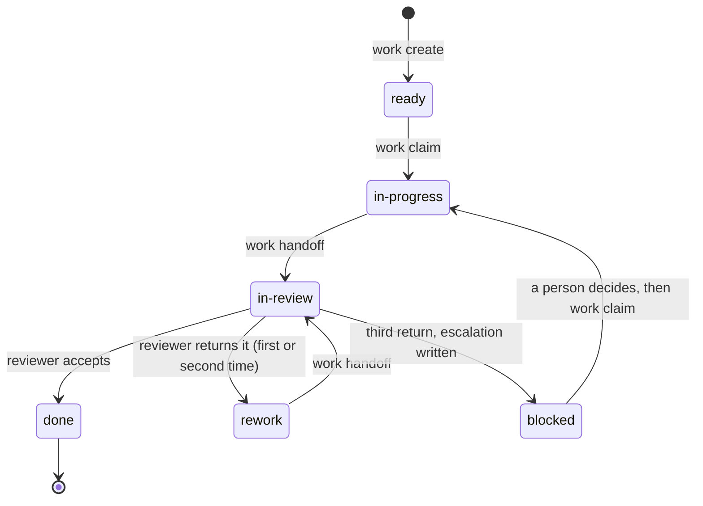
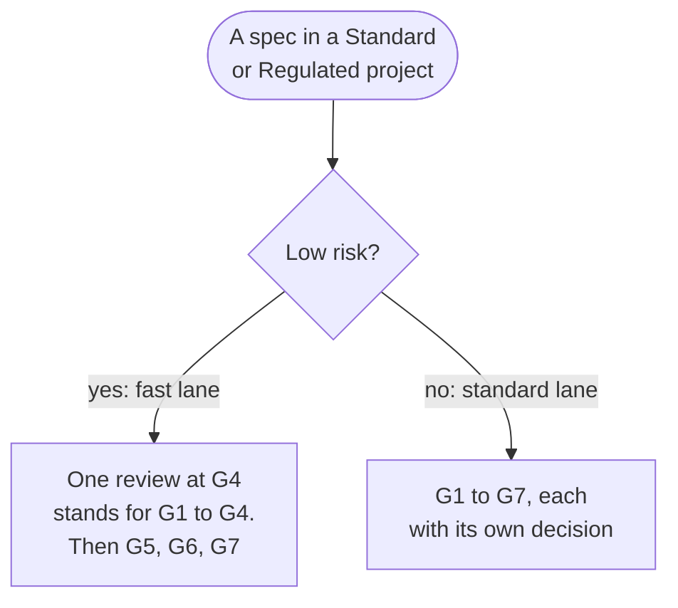
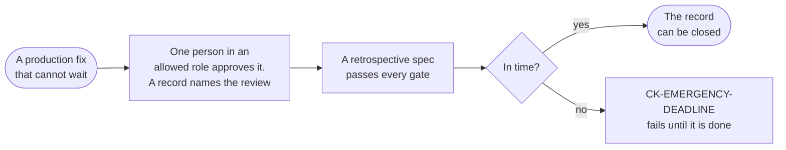
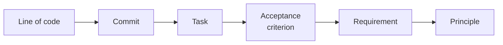
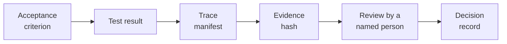

# Workflow guide: one task, the lanes, and the trace from a line of code

- **Phase and date:** after Phase 10, written with the README's workflow diagrams; 2026-11-22
- **Pinned upstream:** github/spec-kit `v1.4.3`
- **Requirement IDs covered:** AGT-3, AGT-4, AGT-6, GOV-17, GOV-18, TRC-1, TRC-3, TRC-4, TRC-18, TRC-19
- **Assumptions:** the defaults in the code. A project may change the emergency roles, the emergency deadline and the fast-lane switch in `kit.yml`
- **Unverified:** nothing here has been run against a live GitHub repository, and no coding-agent runtime has loaded the agent files (`docs/limits.md`, "Never run"). The command output quoted below was read from throwaway copies of `fixtures/multi-app` and from the reference example

The README shows how one change moves, what happens on a pull request, who does what, and a first day. Read it first: it explains the words used here. This page goes one level deeper on three subjects: one task, the lanes, and the trace from a line of code.

In the commands below, `agentic.py` stands for `python .specify/extensions/agentic/scripts/agentic.py` in a project that has the kit installed, and for `python extensions/agentic/scripts/agentic.py` in this repository.

## 1. The life of one task

A work item is one task of a spec's task list, kept as a file: `.specify/agentic/work/<spec>/<task>.yml`. The file holds the task's state, the paths it may change, its history and what was handed off. The state lives in these files and not in any agent's memory, so an agent that starts cold can pick the work up from them.



A task can be returned twice. The third return does not start another round. The item becomes `blocked`, and the kit writes an escalation: a file that holds the author's position, the reviewer's position and the role that is accountable for the item. A person listed in `roles.yml` records the decision in that file. No agent may. Only then can the item be claimed again.

The words on the arrows are sub-commands of `agentic.py work`. Here is each move in full.

| Move | How it happens | The command stops when |
|---|---|---|
| to `ready` | `work create --spec <spec>` makes one item for each open task in `tasks.md` | The spec has no `tasks.md` |
| `ready` to `in-progress` | `work claim --spec <spec> --item T001 --agent <agent>` | The item belongs to another agent. It names no paths. A task it depends on is not done. Another item that is in progress, in review or in rework could edit the same file, migration folder, contract or shared component |
| `in-progress` to `in-review` | `work handoff --spec <spec> --item T001 --agent <agent> --done "<what was done>" --evidence <file>` | Nothing says what was done. An evidence file does not exist. A file outside the item's paths was changed |
| `in-review` to `done` | `work review --spec <spec> --item T001 --by <reviewer> --accept` | No reviewer is named. The reviewer wrote the item. The reviewer is an agent that is not a reviewing agent, or a name that is neither an agent of the team nor a person in `roles.yml` |
| `in-review` to `rework` | `work review --spec <spec> --item T001 --by <reviewer> --return "<what must change>"`, the first and the second time | No finding is given |
| `rework` to `in-review` | The author takes the item up again with `work claim` (the state stays `rework`), fixes it, and runs `work handoff` | As for the first hand-off |
| `in-review` to `blocked` | The same `--return`, the third time | It does not stop. It writes the escalation to `.specify/agentic/work/<spec>/escalations/<task>.yml` and ends with exit code 4 |
| `blocked` to `in-progress` | A person sets the escalation to resolved and names themselves in it. Then `work claim` | No person listed in `roles.yml` has resolved the escalation |

An item can be worked in an isolated working copy of its own (`work claim --worktree`). When such an item is `done`, `work integrate` merges it into the spec's feature branch. It stops when the checkout is on the default branch.

Three more things the kit does around these moves:

- **Paths.** A task line in `tasks.md` names the files it may change, in backticks. `work create` copies them into the item. While the item is in progress, in review or in rework, no other item may claim an overlapping path. This is the path lock.
- **Context.** `work claim` builds a context pack for the item: the task, its criteria, and what the agent needs to know about the files in play. The agent is given that pack. It does not gather its own.
- **Record.** Every move is written to the spec's audit log, with who made it.

Two checks read the item files afterwards. `CK-WORKITEM` fails when an item's history shows a move that is not allowed, for example `ready` straight to `done`, or when an item is done with no hand-off evidence. `CK-REWORK-LIMIT` fails when an item has more than two rework rounds, or has moved on from an escalation that no person resolved. The checks accept a few moves that no command makes: any working state to `blocked`, `in-progress` back to `ready`, and `blocked` to `ready`, `in-review` or `done`.

A real example: `examples/healthq/project/.specify/agentic/work/004-audit-identity/T001.yml`. Its history reads `ready`, `in-progress`, `in-review`, `rework` (returned by the security reviewer), `in-review`, `done`. The run log in `docs/phase-reports/phase-7-c4-walkthrough.md`, section 3, tells the same story step by step.

Limits:

- A review has two outcomes, accept and return. A reviewer who accepts and still wants something changed later can only say so in prose.
- The kit knows what an item changed only in a git repository. A write made through a shell command is not blocked when it happens. It is caught at hand-off and in the pipeline.
- Run from a linked git worktree that the kit did not make, the kit writes its records into the repository's main working copy.

## 2. The lanes

A lane is the route a change takes through the gates. There are three. Two of them are computed by the kit. The third is declared by a person.



`agentic.py lane` prints the lane of each spec and the gates that follow from it, for example `040-docs: fast lane; gates G4, G5, G6, G7`.

**Nobody chooses the lane.** "Low risk" has an exact meaning. All of this must be true:

- The spec says which components it touches, and the project's system map knows every one of them.
- Every one of those components is Low tier, and the spec declares the tier `low`.
- The change triggers no change pack. A change pack is the set of extra rules for a data store, a contract, a shared component or an external system. A spec that touches one of those is never on the fast lane.
- The project has not switched the fast lane off (`lanes.fast.enabled: false` in `kit.yml`).

If a spec writes `lane: fast` in its own front matter and the kit computes something else, the check `CK-LANE` fails. The same check fails when a spec was approved on the fast lane and no longer qualifies: G1 to G3 then need their own decisions.

**The name "standard lane" is the kit's.** It has nothing to do with the Standard profile. A Lite project is always on the standard lane, with its three gates.

**What the fast lane asks for.** One review at G4. Its evidence is the evidence of G1 to G4 together: the spec, the plan, the impact report, the task list and the trace manifest. Its approvers are everyone G1 to G4 would have asked. After that, G5, G6 and G7 are the same as on the standard lane.



**The emergency lane** lets a fix go in first and be specified afterwards.

- One person approves the fix in a pull-request review. By default that person holds the DevOps / SRE, Engineering Manager or Security and Compliance role. `lanes.emergency.roles` in `kit.yml` changes the list.
- An emergency record is a file under `.specify/agentic/emergencies/`. It names the review, the commit, the paths of the fix, the date, and the retrospective spec. There is no command that writes it.
- The retrospective spec must pass every gate of its profile and lane within the number of days in `lanes.emergency.days`. A project with an emergency record and no such setting fails the check.
- The check `CK-EMERGENCY-DEADLINE` fails when the review is missing or not valid. It fails when the record gives itself more time than `kit.yml` allows, or is closed before the retrospective is complete. After the deadline it fails on every run until the retrospective is complete.
- While the record is open, changes under its paths are not reported as changes with no spec.

The emergency lane has never been used on a live repository. Its review is read through the same path as any other review, and that path has only been tested on recorded responses.

| Lane | Who puts a change on it | Gates | What it asks for |
|---|---|---|---|
| Standard | The kit: every spec that is not on the fast lane | All the gates of the profile | A decision at each gate |
| Fast | The kit, from impact analysis. Standard and Regulated only | G4, G5, G6, G7 | One review at G4 that stands for G1 to G4 |
| Emergency | A person in an allowed role, by a review and a record | One approval now. Every gate of the retrospective spec later | The retrospective inside the deadline |

## 3. From a line of code back to the reason

Every link between a requirement and the code that meets it is written down somewhere. One command follows the links from a line of code:

```bash
agentic.py why <file>:<line>
```



This is the path `why` walks, from left to right. The second diagram shows what stands behind an approval.



Each arrow is one link. The table says how each is made, and which check fails when it is missing.

| Link | How it is made | Checked by |
|---|---|---|
| Line to commit | Git history: the commit that last changed the line | Nothing. It is read from git |
| Commit to task | The commit message ends with `Work-Item: <spec>/<task>`. The kit writes that line when it commits a hand-off from an isolated working copy. A person who commits by hand writes it themselves | `CK-PATH-DIFF`: such a commit must stay inside the task's paths |
| Task to criterion | The task's line in `tasks.md` says `Carries: AC-001` | `CK-TRACE` |
| Criterion to requirement | `spec.md` says `**AC-001** (verifies FR-001)` | `CK-TRACE` |
| Requirement to principle | The spec's front matter lists the principles it is held to, for example `principles: [P-1]` | `CK-TRACE` |
| Criterion to test result | The test's name contains the criterion id, as in `test_AC_001_reply_contains_name`. Results are read from JUnit XML files under `specs/<spec>/evidence/` | `CK-TRACE`: a criterion whose test failed, or that has no test and no open task, is a gap |
| Test result to trace manifest | `agentic.py trace --write` builds `specs/<spec>/trace-manifest.json` | `CK-TRACE-GENERATED`: the file must be exactly what the kit builds |
| Trace manifest to evidence hash | The manifest is one of the evidence files of G4 and G5. `agentic.py gate` hashes a gate's evidence files together | `CK-GATE-RECORD` |
| Evidence hash to review | The reviewer pastes the line with the hash into the review | `CK-GATE-MIRROR` |
| Review to decision record | `agentic.py record`, or `connect mirror`, writes the record: the gate, the commit, the hash, and who approved in which role | `CK-APPROVER` |

`why` prints more than the first diagram shows. It also prints the component the file belongs to on the system map, what the spec touches and reaches, the request the spec came from, and who approved each gate. This is the start of its output for one line of the worked example. The full text is in `examples/healthq/project/specs/004-audit-identity/evidence/trace-lines.md`.

```text
# Why `src/HealthQCopilot.Infrastructure/Middleware/PhiAuditMiddleware.cs:162` is the way it is

- **Last changed:** 2026-11-22 in `d5902a2c1b` by agentic-kit, agent backend-implementer
- **Work item:** 004-audit-identity/T001

## Spec 004-audit-identity: Audit records name the authenticated user
- **Task T001 carries:** AC-002, AC-003, AC-004
- **FR-002:** An audit record MUST carry the user identifier from the validated token of the request it describes.
- **FR-003:** A request to an audited path that is refused for lack of a valid token MUST still produce an audit record, marked as unauthenticated.
- **Principle P-9:** Every access to PHI is attributed
- **Component:** `event-hubs-audit` (event-stream, owner security-compliance, tier critical)
```

The same output ends with the line `- **Approvals:** none recorded yet`. That is true: no gate of that spec has a decision record.

Limits:

- `why` comes with the product extension (`extensions/agentic-product`). The install script adds it for Standard and Regulated, not for Lite.
- The trace rests on the commit that last changed the line. When that commit names no work item, `why` lists every spec that claims the file, which can be several.
- Records name commits by id. A change that is rebased or squashed keeps its files and loses its ids. The `Work-Item` line in a commit message survives that.
- In Lite the trace stops at requirement and task. Test results are not read, and the trace manifest is not required.
- The kit reads test results as given. It does not run the tests.

## What each diagram was checked against

Each box, arrow, state, role, gate and command in the diagrams of the README and of this page was looked up in the code or the documents on 2026-11-22. If you change one of these files, check the diagram too. Paths are shortened: `agentic_kit/` is `extensions/agentic/scripts/agentic_kit/`, `agentic_kit_team/` is `extensions/agentic-team/scripts/agentic_kit_team/`, `agentic_kit_system/` is `extensions/agentic-system/scripts/agentic_kit_system/` and `agentic_kit_product/` is `extensions/agentic-product/scripts/agentic_kit_product/`.

| Diagram | Where | Checked against |
|---|---|---|
| How one change moves | README | `PROFILE_GATES` in `agentic_kit/core.py`; `DEFAULT_APPROVERS` and `gate_roles` in `agentic_kit/checks_gov.py`; `DEFAULT_EVIDENCE` in `agentic_kit/__main__.py`; `ck_amendment` in `agentic_kit/lanes.py`; `workflows/agentic-sdd/workflow.yml`; `steps/agentic-gate/__init__.py`; `docs/guide/roles.md` |
| What happens on a pull request | README | `extensions/agentic/ci/agentic-checks.yml`; `cmd_gate`, `cmd_record` and `cmd_brief` in `agentic_kit/__main__.py`; `ck_approver`, `ck_gate_mirror` and `ck_gate_record` in `agentic_kit/checks_gov.py`; `ck_amendment` in `agentic_kit/lanes.py`; `view_gates` in `agentic_kit/reports.py`; `docs/guide/roles.md`; `docs/admin-setup.md`; `docs/limits.md`. The two messages quoted in step 6 were read from the commands, run on a throwaway copy of `fixtures/multi-app` |
| Who does what | README | The agent specs in `extensions/agentic-team/agents/`; `COMMON_NEVER` and `STAGES` in `agentic_kit_team/agents.py`; `extensions/agentic-team/commands/orchestrate.md`; `review` and `integrate` in `agentic_kit_team/work.py`; `ck_cred` in `agentic_kit_team/checks_team.py`; `GRANTS` in `agentic_kit_team/ops.py`; `docs/prompts/spec/15-agent-team.md`; `docs/limits.md` |
| Your first day | README | `cmd_doctor`, `cmd_check`, `_report` and `cmd_gate` in `agentic_kit/__main__.py`; `view_gates` in `agentic_kit/reports.py`; `docs/install.md`; `extensions/agentic/commands/check.md`. The four commands were run on a copy of `fixtures/multi-app`, inside and outside a git repository, and the copy was compared with the original afterwards |
| The life of one task | This page | `STATES`, `LEGAL`, `LOCKING`, `REWORK_LIMIT`, `claim`, `handoff`, `review` and `integrate` in `agentic_kit_team/work.py`; `cmd_work` in `agentic_kit_team/__init__.py`; `ck_workitem` and `ck_rework_limit` in `agentic_kit_team/checks_team.py`; `docs/design/schemas.md`. Every move in the table was made with the commands on a throwaway copy of `fixtures/multi-app` |
| The lanes | This page | `lane`, `required_gates`, `gate_roles` and `FAST_MERGED` in `agentic_kit/checks_gov.py`; `ck_lane` and `ck_emergency_deadline` in `agentic_kit/lanes.py`; `cmd_lane` and `_evidence_files` in `agentic_kit/__main__.py`; `lane_hook` and `compute_impact` in `agentic_kit_system/checks_map.py`; `docs/guide/roles.md`; `docs/prompts/spec/10-governance.md`; `tests/test_lanes.py` |
| From a line of code back to the reason | This page | `why`, `last_change` and `carried_by` in `agentic_kit_product/lineage.py`; `build_manifest`, `ck_trace` and `ck_trace_generated` in `agentic_kit/checks_trace.py`; `evidence_hash` in `agentic_kit/core.py`; `DEFAULT_EVIDENCE` and `cmd_record` in `agentic_kit/__main__.py`; `handoff` in `agentic_kit_team/work.py`; `ck_path_diff` in `agentic_kit_team/checks_team.py`; `why_hook` in `agentic_kit_system/checks_map.py`; `docs/prompts/spec/11-traceability-and-audit.md`; `docs/limits.md` |
